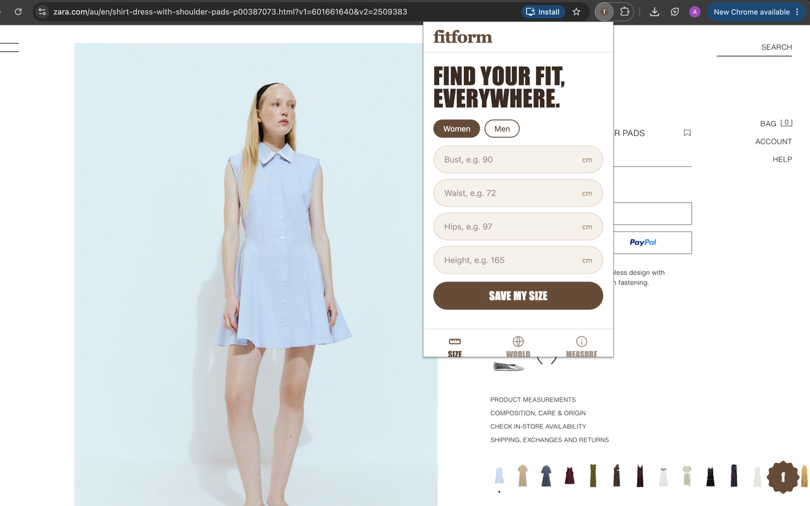
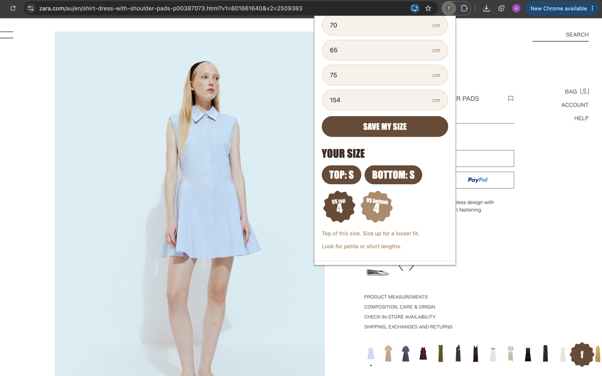
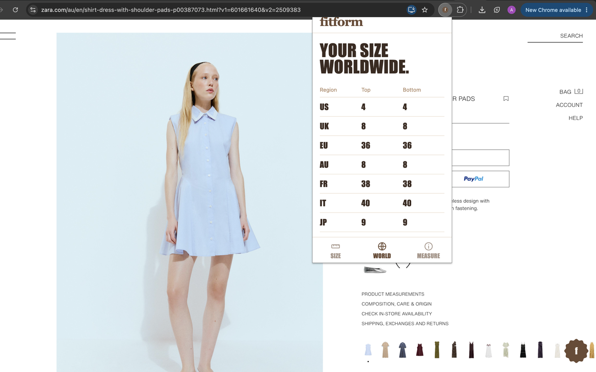
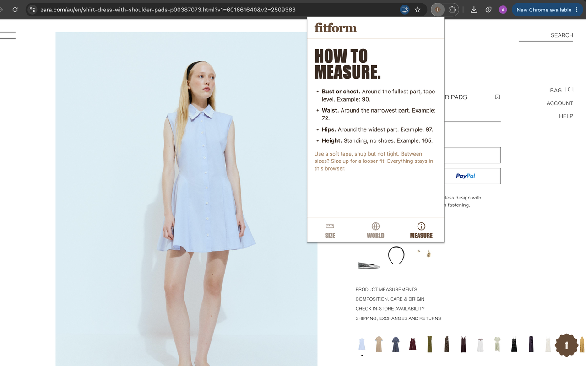

# FitForm

Size finder for men and women. Static website plus browser extension. Plain JavaScript, no backend.

> **Status:** the Chrome extension is currently under review by the Chrome Web Store and should be available within about a week. Until then you can install it manually (see below).

## Screenshots

Enter your measurements once, then see your size on any product page.

| Save your measurements | Your size |
| --- | --- |
|  |  |

| Your size worldwide | How to measure |
| --- | --- |
|  |  |

## How it works
1. Click the FitForm icon in the toolbar and enter your bust or chest, waist, hips and height.
2. Browse a clothing product page (Zara, H&M, or any shop that marks its pages as products).
3. Click the round **f** button at the bottom right of the page to see your size there.

## Run locally
    python3 -m http.server -d public
Open http://localhost:8000.

## Deploy to Vercel
https://fitform-public.vercel.app/

## Install the extension
1. Open chrome://extensions and turn on Developer mode.
2. Click Load unpacked and pick the `extension` folder.
3. Click the FitForm icon, save your measurements, then visit Zara or H&M.

## Data
Size charts and their sources are in `public/sizing.js` (see SOURCES). Charts vary by country, so check them against each brand's own guide before launch.

## Global coverage
Every result starts from a worldwide size chart, so it works for any brand. Brands with their own chart get a second, more exact answer. To add a brand, copy a block in `CHARTS` (top = [chest, waist], bottom = [waist, hip], upper limits in cm) and add its domain in `extension/content.js`.
The extension runs on pages that look like product pages (product metadata) and on Zara and H&M. It reads nothing but that page metadata, and sends nothing anywhere.

## Privacy
Your measurements never leave your browser. See the [privacy policy](PRIVACY-POLICY-LINK-ADD).

## Security
- Permissions: `storage` only. The content script matches https pages so it can spot product pages on any shop, but it only reads product metadata. There is no network access and nothing remote. The manifest CSP blocks all outside connections and inline scripts.
- Measurements live in `chrome.storage.local` (this device only, not synced).
- No `innerHTML` anywhere. All text is set with `textContent`.
- The on-page badge sits in a closed shadow DOM, so the page cannot read it or restyle it. It runs in the top frame only, on https pages that look like product pages.
- No `web_accessible_resources`, so websites cannot load files from the extension.
- Input is validated and range-checked before anything is saved or shown.
